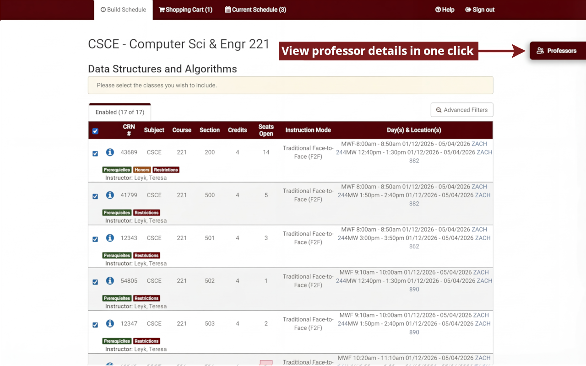

# AggieSB+ Registration Assistant

A Chrome and Firefox extension that puts professor grades, ratings and review summaries right inside Texas A&M's registration site.

**Site:** https://aggiesbp.com (moved from aggieschedulebuilderplus.vercel.app in November 2026; the old address redirects) · **Frontend:** [AggieSBP-Frontend](https://github.com/nitheesh-cpu/AggieSBP-Frontend) · **Backend:** [AggieSBP-Backend](https://github.com/nitheesh-cpu/AggieSBP-Backend)



## Features

**On College Scheduler**
- Grade distributions, ratings and AI review summaries for every professor teaching a course
- One-click compare on the AggieSB+ site
- Watch full sections and get notified when a seat opens
- "Fit my schedule" finds classes that fit around your current schedule

**On Howdy**
- Import your degree planner courses into the AggieSB+ schedule builder

## Permissions

| Permission | Why |
| --- | --- |
| `storage` | Theme and settings |
| `cookies` | Reuse your AggieSB+ sign-in for seat alerts |
| `alarms` | Keep that session fresh |
| `activeTab` | Popup access to the current tab |
| Access to `aggiesbp.com` (optional) | Read your sign-in on the site. Asked for once, on a click, when you sign in from the extension |

No remote code. Course data only goes to AggieSB+ when you click import.

Anonymous usage counts (sidebar opened, courses imported, and so on, with no names, courses, grades or professors) go to the AggieSB+ Umami instance from the background script (`src/background.ts`). Users can turn them off under Settings in the popup (`usageStatsEnabled` in `chrome.storage.sync`). Firefox builds send nothing unless the user grants the optional `technicalAndInteraction` data collection permission. The privacy policy is at https://aggiesbp.com/privacy (source: `frontend/src/app/privacy/page.tsx`); keep it in sync when the event list changes.

## Development

Prerequisites: Node 20+ (`package.json` does not declare an `engines` field).

```bash
npm ci
npm run build          # Chrome build in build/
npm run firefox        # Firefox build in build-firefox/ (runs the Chrome build first)
node --test tests/*.cjs
```

Store zips: `npm run build:zip` (`build.zip`) and `npm run firefox:zip` (`build-firefox.zip`).

### Load it locally

- Chrome: open `chrome://extensions`, enable Developer mode, choose Load unpacked, and select `build/`.
- Firefox: open `about:debugging#/runtime/this-firefox`, choose Load Temporary Add-on, and select `build-firefox/manifest.json`.

### End-to-end tests

Playwright loads the real built extension into Chromium and checks what a user sees: the sidebar button and professor panel on College Scheduler, Fit My Schedule, seat alerts, the Howdy import panel, the popup, onboarding and the anonymous usage events. No real TAMU site or AggieSB+ server is contacted: the tests serve small HTML fixtures (`e2e/fixtures/`) at the real URLs and answer the API with mocks (`e2e/helpers/`), and analytics requests are captured, never sent.

```bash
npm ci
npx playwright install chromium    # once; add --with-deps on Linux
npm run build                      # the tests load build/
npm run test:e2e                   # HEADED=1 npm run test:e2e to watch; npx playwright show-report for the report
```

### Configuration

The API and site URLs are constants in `src/config/constants.ts` (`EXTERNAL_API_BASE`, `COURSE_DETAILS_BASE`). There are no environment variables; edit that file to point at a local backend or site. The manifests already allow `http://localhost:8000` and `http://localhost:3000`.

Built with TypeScript, Vite and Manifest V3.

## Reproduce the Firefox Add-ons build

The release build uses Ubuntu 24.04 (x86-64) and Node.js 24 with its bundled npm.
Unpack the submitted source archive and run these commands from the directory
containing `package-lock.json`:

```bash
npm ci
npm run firefox
```

Compare the files in `build-firefox/` with the submitted add-on. The build needs
no API credentials or environment variables.

## License

MIT, see [LICENSE](LICENSE).
