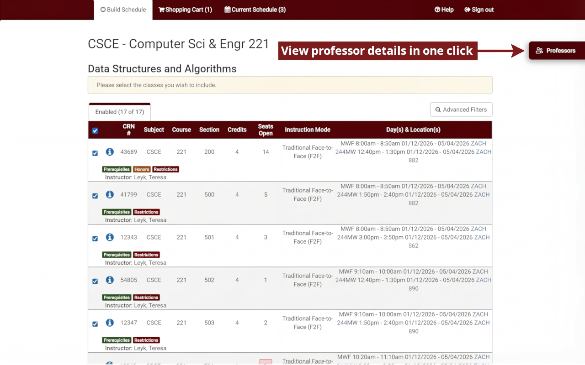

# AggieSB+ Registration Assistant

A Chrome and Firefox extension that puts professor grades, ratings and review summaries right inside Texas A&M's registration site.

**Site:** https://aggieschedulebuilderplus.vercel.app · **Frontend:** [AggieSBP-Frontend](https://github.com/nitheesh-cpu/AggieSBP-Frontend) · **Backend:** [AggieSBP-Backend](https://github.com/nitheesh-cpu/AggieSBP-Backend)



## Features

**On College Scheduler**
- Grade distributions, ratings and AI review summaries for every professor teaching a course
- One-click compare on the AggieSB+ site
- Watch full sections and get notified when a seat opens
- "Fit my schedule" finds classes that fit around your current schedule

**On Howdy**
- Import your degree planner courses into the AggieSB+ schedule builder

## Permissions

| Permission | Why |
| --- | --- |
| `storage` | Theme and settings |
| `cookies` | Reuse your AggieSB+ sign-in for seat alerts |
| `alarms` | Keep that session fresh |
| `activeTab` | Popup access to the current tab |

No remote code. Course data only goes to AggieSB+ when you click import.

## Development

```bash
npm install
npm run build          # Chrome build in build/
npm run firefox        # Firefox build in build-firefox/
node --test tests/*.cjs
```

Load `build/` as an unpacked extension in `chrome://extensions`, or `build-firefox/manifest.json` as a temporary add-on in Firefox.

Store zips: `npm run build:zip` and `npm run firefox:zip`.

Built with TypeScript, Vite and Manifest V3.
